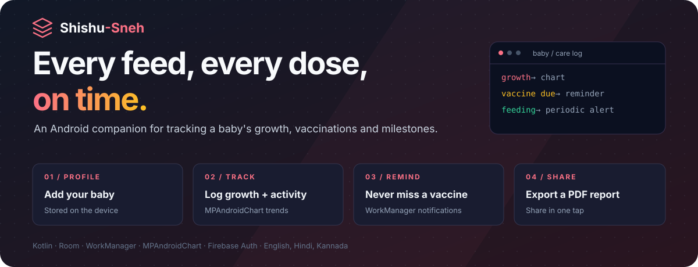
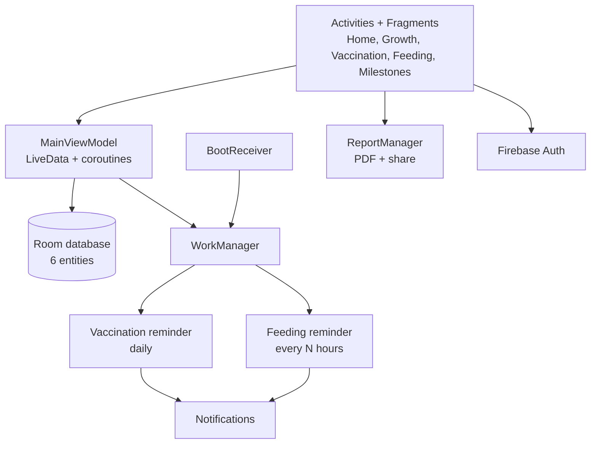

<p align="center">
  
</p>

<p align="center">
  <strong>Smart baby care and growth tracking for Android.</strong><br />
  Growth charts, vaccination reminders, feeding alerts and milestone tracking in one app, in English, Hindi and Kannada.
</p>

<p align="center">
  
  
  
  
  
</p>

<p align="center">
  <a href="#the-product">Product</a> ·
  <a href="#engineering-decisions">Engineering</a> ·
  <a href="#architecture">Architecture</a> ·
  <a href="#screens">Screens</a> ·
  <a href="#run-locally">Run locally</a> ·
  <a href="#creator">Creator</a>
</p>

---

## The product

New parents juggle a lot: vaccination due dates, feeding intervals, weight and height checks, first milestones. Paper cards get lost, and a missed vaccine date is easy to overlook.

**Shishu-Sneh (शिशु स्नेह, "love for the child") keeps a baby's care history and schedule in one place and reminds you before something is due.** Data lives in a local database on the phone, reminders run in the background even after a reboot, and a report can be exported as a PDF to share with a doctor.

| Capability | What you can do |
| :--- | :--- |
| **Baby profiles** | Create and manage a profile for each child. |
| **Growth tracking** | Log weight and height over time and see the trend on a chart (MPAndroidChart). |
| **Vaccination tracker** | Track scheduled vaccines and mark them done; get a notification for any dose due in the next 7 days. |
| **Feeding reminders** | Set a feeding interval in hours and receive periodic reminders. |
| **Milestones & activity log** | Record developmental milestones and daily activities: feeding, sleep, diaper changes and growth checks. |
| **PDF report** | Generate an A4 report of the profile and recent activity and share it through any app. |
| **Voice feedback** | Spoken confirmations on the home, feeding and vaccination screens through Android Text-to-Speech. |
| **Languages** | English, Hindi (`values-hi`) and Kannada (`values-kn`) string resources. |
| **Accounts** | Email/password sign-up and login with Firebase Authentication. |

### A workflow you can follow

**Sign up → add your baby → log growth and activities → get reminders → export a report**

## Engineering decisions

| Engineering problem | Implementation | Inspect the code |
| :--- | :--- | :--- |
| Reminders must fire even when the app is closed | Periodic `WorkManager` jobs check due vaccinations daily and post notifications. | [`VaccinationReminderWorker`](app/src/main/java/com/example/shishusneh/workers/VaccinationReminderWorker.kt), [`FeedingReminderWorker`](app/src/main/java/com/example/shishusneh/workers/FeedingReminderWorker.kt) |
| A phone restart should not cancel reminders | A boot receiver re-enqueues the daily vaccination check after `BOOT_COMPLETED`. | [`BootReceiver`](app/src/main/java/com/example/shishusneh/workers/BootReceiver.kt) |
| Care data should work offline | Room entities and DAOs for profiles, growth, vaccinations, milestones and activities, exposed as Flows. | [`AppDatabase`](app/src/main/java/com/example/shishusneh/data/AppDatabase.kt), [DAOs](app/src/main/java/com/example/shishusneh/data/dao) |
| UI state should survive configuration changes | MVVM with a shared `MainViewModel`, LiveData and coroutines. | [`MainViewModel`](app/src/main/java/com/example/shishusneh/viewmodel/MainViewModel.kt) |
| Doctors want something they can read | Android's `PdfDocument` draws an A4 report that is shared through a `FileProvider` intent. | [`ReportManager`](app/src/main/java/com/example/shishusneh/ui/utils/ReportManager.kt) |
| Not every parent reads English | All user-facing strings have Hindi and Kannada translations. | [`res/values-hi`](app/src/main/res/values-hi), [`res/values-kn`](app/src/main/res/values-kn) |

## Architecture



| Layer | Technology |
| :--- | :--- |
| Language & UI | Kotlin, XML layouts with View Binding, Material Components |
| Architecture | MVVM: ViewModel, LiveData, Kotlin coroutines |
| Storage | Room (with KSP) |
| Background work | WorkManager, boot receiver |
| Charts & images | MPAndroidChart, Coil |
| Auth | Firebase Authentication |
| Build | Gradle Kotlin DSL, compile/target SDK 34, Java 17 |

## Screens

<p align="center">
  
  
  
  
</p>
<p align="center">
  
  
  
  
</p>

<details>
<summary><strong>Scope and known limitations</strong></summary>

- Care records are stored only on the device; there is no cloud backup or sync between phones yet.
- Feeding and vaccination guidance in the app is general information, not medical advice.
- There are no automated tests beyond the default Android test templates.
- No published APK or Play Store listing yet; build it from source.

</details>

## Run locally

Requirements: **Android Studio** (recent stable), **JDK 17**, and an Android device or emulator running **Android 8.0 (API 26)** or newer.

```bash
git clone https://github.com/Lingu17/Shishu-Sneh.git
```

1. Open the folder in Android Studio and let Gradle sync.
2. Firebase: the app uses Firebase Authentication. To use your own Firebase project, replace `app/google-services.json` with the file from your project and enable **Email/Password** sign-in.
3. Run the `app` configuration on a device or emulator.
4. On Android 13+, allow notifications when prompted so reminders can appear.

The Gradle wrapper scripts (`gradlew`, `gradlew.bat`) are not committed, so build from Android Studio, or run `gradle wrapper` once with a local Gradle install before using `./gradlew assembleDebug`.

## Project map

```text
Shishu-Sneh/
└── app/src/main/
    ├── java/com/example/shishusneh/
    │   ├── data/            Room database, entities and DAOs
    │   ├── ui/              Activities, fragments, adapters, bottom sheets
    │   │   └── utils/       PDF report and voice feedback managers
    │   ├── viewmodel/       MainViewModel
    │   └── workers/         Vaccination and feeding reminders, boot receiver
    ├── res/                 Layouts, drawables, strings (en, hi, kn)
    └── AndroidManifest.xml  Activities, permissions, boot receiver
```

## Creator

**Lingraj Malipatil** · [GitHub @Lingu17](https://github.com/Lingu17) · [LinkedIn](https://www.linkedin.com/in/lingraj-malipatil-a2735a241/)

---

<p align="center"><strong>Shishu-Sneh</strong><br />Every feed, every dose, on time.</p>
